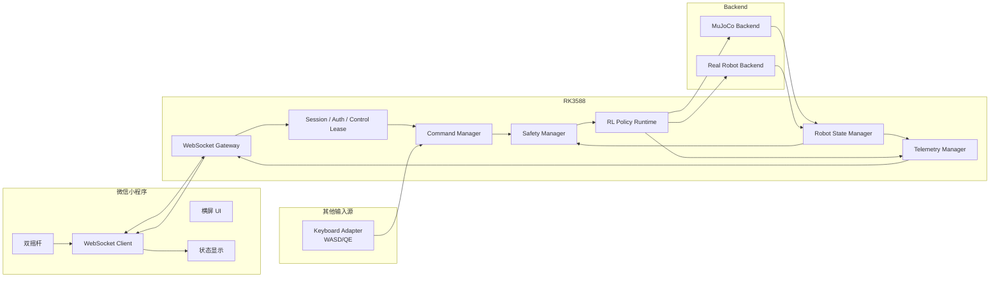

# 基于微信小程序与 RK3588 的四足机器人无线遥控系统项目计划书

> 文档版本：V2.0  
> 项目对象：12 自由度四足机器人  
> 控制终端：微信小程序（横屏）  
> 机器人主控：RK3588  
> 控制方式：强化学习速度控制 `vx / vy / wz`  
> 文档状态：总体架构与实施计划  
> 原则：先打通最小闭环，再逐步增加遥测、认证、生产化能力

---

# 0. 本版修订重点

本版在原计划基础上重点做以下调整：

1. **进一步明确项目边界**：整个遥控系统分为“小程序端”和“RK3588 机器人端”两大部分，MuJoCo 与真实机器人只作为机器人端的不同执行后端。
2. **调整实施顺序**：当前小程序横屏 UI、双摇杆、Mock、基础 WebSocket 协议已经完成，因此后续不再从 UI Mock 重新开始，而是优先完成：
   - 协议冻结；
   - 小程序 ↔ WebSocket 本机闭环；
   - 小程序 ↔ MuJoCo 端到端控制；
   - RK3588 部署；
   - 实机低速联调。
3. **连接状态与机器人状态分离**：网络连接状态不再混入机器人运动状态，分别建立 Connection State 与 Robot State。
4. **新增控制权机制**：一个机器人同一时刻只允许一个控制端拥有运动控制权，避免两个手机或键盘与手机同时驱动。
5. **新增协议握手与能力协商**：正式定义 `client_hello / server_hello / claim_control / release_control`，为协议版本、机器人编号、软件版本和功能能力预留统一入口。
6. **明确命令速度与实测速度的区别**：小程序显示“机器人接受的目标速度”和“机器人实际估计速度”时必须使用不同字段，不能混为一个 `vx/vy/wz`。
7. **安全参数以 RK3588 为最终权威**：小程序可以做 UI 限幅，但真正的速度、加速度、急停、超时等安全约束必须由机器人端再次执行。
8. **软件急停与物理急停严格区分**：软件急停是通信控制层的锁存安全状态，不能替代真实硬件物理急停。
9. **新增版本管理、风险矩阵、日志策略和交付物定义**。
10. **减少过度工程化**：首版不强制拆成大量微服务或多进程，优先保证链路简单、可靠、可调试；实机稳定后再做进程级隔离。

---

# 1. 项目背景与目标

本项目为自研 12 自由度四足机器人开发一套手机无线遥控系统。

机器人已具备强化学习运动控制能力，并已经能够通过键盘：

- `W / S`：前进 / 后退；
- `A / D`：左右横移；
- `Q / E`：绕 Z 轴旋转；

控制 MuJoCo 中的机器人。

当前目标不是重新设计运动控制器，而是将已有键盘控制能力抽象成统一速度接口，再通过微信小程序向机器人发送同样的速度目标。

最终链路：

```text
微信小程序
    ↓
WebSocket
    ↓
RK3588
    ↓
Command Manager
    ↓
Safety Manager
    ↓
VelocityCommand(vx, vy, wz)
    ↓
RL Policy Runtime
    ↓
┌───────────────┬────────────────┐
│ MuJoCo Backend│ Real Robot     │
│               │ Backend        │
└───────────────┴────────────────┘
```

核心目标：

1. 小程序直接产生 `vx / vy / wz`，不模拟 WASD/QE 键盘事件。
2. 键盘、小程序等都只是“命令输入源”。
3. MuJoCo 与真实机器人共享上层通信、命令管理、安全逻辑。
4. 从仿真切换到实机时，小程序协议原则上无需修改。
5. 网络通信异常时机器人必须自动进入安全状态。
6. 机器人内部实时控制不依赖小程序网络频率。
7. 整套系统具备可调试、可记录、可升级、可回滚能力。

---

# 2. 当前工程状态

## 2.1 已完成

### 小程序端

当前已具备：

- 横屏遥控界面；
- 左右双虚拟摇杆；
- 左摇杆：
  - `vx` 前进 / 后退；
  - `vy` 左右横移；
- 右摇杆：
  - `wz` 绕 Z 轴旋转；
- WebSocket 基础通信；
- Mock 模式；
- `cmd_vel`；
- `heartbeat`；
- `stop`；
- `estop`；
- `estop_clear`；
- 递增 `seq`；
- WebSocket 连接状态显示；
- `vx / vy / wz` 显示；
- 最后发送 JSON 显示；
- 松手回中；
- 页面隐藏、退出、断开时速度归零；
- 急停后禁止继续发送运动命令。

### 机器人 / 仿真端

当前已有：

- 键盘 WASD/QE 控制；
- 统一速度语义 `vx / vy / wz`；
- MuJoCo 仿真机器人；
- RL Policy 运动控制链路；
- WebSocket 原型服务；
- 基础 JSON 编解码；
- 基础超时、急停、序号处理思想。

---

## 2.2 当前最重要的技术缺口

正式接入 MuJoCo 和实机前，需要优先解决：

### 1. 命令超时与心跳超时必须完全分离

机器人端至少维护：

```text
last_command_rx_time
last_heartbeat_rx_time
```

规则：

- `cmd_vel` 只刷新 `last_command_rx_time`；
- `heartbeat` 只刷新 `last_heartbeat_rx_time`；
- heartbeat 持续正常时，旧的非零 `cmd_vel` 仍然必须按命令超时失效。

### 2. WebSocket 不能直接调用 RL Policy 或电机接口

网络层只能负责：

- 连接；
- 协议解析；
- 校验；
- 会话；
- 控制权；
- ACK；
- 遥测发送。

最终运动命令必须进入：

```text
Command Manager
    ↓
Safety Manager
    ↓
VelocityCommand
```

### 3. `seq` 必须以会话为作用域

每次重新建立 WebSocket 连接后创建新的 `session_id`。

`seq` 只在当前会话中要求单调递增。

不能使用“机器人全局永不回退 seq”，否则手机重连或重启后容易被误判。

### 4. 当前缺少独立的遥测发布机制

不能只在“收到手机消息”时才返回状态。

需要独立的 Telemetry Publisher 按固定频率向客户端推送机器人状态。

### 5. 当前缺少控制权机制

同一时刻只允许一个控制源真正驱动机器人。

MVP：

```text
NONE
KEYBOARD
WECHAT(session_id)
```

禁止两个控制源的速度叠加。

### 6. 当前缺少正式握手与版本协商

需要能够知道：

- 小程序版本；
- 协议版本；
- RK3588 软件版本；
- Policy 版本；
- 当前后端是 MuJoCo 还是实机；
- 机器人支持哪些功能。

---

# 3. 项目范围与职责边界

整个项目明确分为两大部分。

---

## 3.1 小程序端

小程序负责：

### 控制输入

- 双摇杆；
- `vx / vy / wz` 生成；
- 停止；
- 急停；
- 解除急停；
- 后续的站立、趴下、模式切换等离散操作。

### UI

- 横屏布局；
- 机器人连接状态；
- 控制权状态；
- 当前速度目标；
- 实际运动状态；
- 电池；
- IMU；
- 网络质量；
- CPU/GPU/温度；
- 故障；
- RL Policy 状态。

### 网络客户端

- WebSocket 建立 / 断开；
- 自动重连；
- heartbeat；
- RTT；
- 协议编码；
- 状态解析。

### 本地安全行为

- 摇杆松手归零；
- 页面进入后台归零；
- 触控取消归零；
- 网络断开归零；
- 急停后禁止本地继续产生运动命令。

> 小程序端的安全逻辑只作为第一层保护。  
> 真正安全裁决必须在 RK3588 再执行一次。

---

## 3.2 RK3588 机器人端

RK3588 负责：

- WebSocket Server；
- 会话管理；
- 协议解析；
- 认证；
- 控制权管理；
- 命令仲裁；
- watchdog；
- cmd 超时；
- heartbeat 超时；
- stop；
- estop；
- estop_clear；
- 速度 / 加速度限幅；
- 机器人状态机；
- RL Policy Runtime；
- MuJoCo / 实机适配；
- 遥测采集；
- 日志；
- 配置；
- 错误码；
- 服务启动与自动恢复。

机器人端是整个遥控系统的最终安全权威。

---

# 4. 总体架构



---

# 5. 统一控制模型

## 5.1 VelocityCommand

所有上层输入最终统一为：

```text
VelocityCommand {
    vx: float
    vy: float
    wz: float
}
```

全系统坐标约定：

```text
X：机器人前方
Y：机器人左方
Z：机器人上方

vx > 0：前进
vy > 0：向左横移
wz > 0：绕 +Z 逆时针旋转

单位：
vx / vy：m/s
wz：rad/s
```

使用右手坐标系。

若当前 RL Policy 内部符号与上述约定不同，只允许在：

```text
RL Adapter
```

做一次转换。

不允许在：

- 小程序；
- WebSocket；
- Command Manager；

多处分别翻转符号。

---

## 5.2 CommandContext

机器人内部使用：

```text
CommandContext {
    command: VelocityCommand
    source: keyboard | wechat
    session_id
    seq
    received_at_monotonic
    expires_at_monotonic
}
```

客户端 `timestamp`：

- 用于 RTT 和日志；
- 不作为安全超时的最终时间来源。

机器人端安全超时统一使用 RK3588 本机单调时钟。

---

# 6. 通信协议 V1

## 6.1 总体原则

- WebSocket 作为当前遥控通信通道；
- JSON 用于第一版协议，便于调试；
- 所有消息都有 `type`；
- 每个客户端会话有独立 `session_id`；
- `seq` 在单个客户端会话内递增；
- 离散操作必须 ACK；
- 高频 `cmd_vel` 不逐包返回完整 ACK；
- 无效字段、错误类型、NaN、Infinity 必须拒绝；
- 限制单条消息最大尺寸；
- 未知但允许扩展的可选字段可忽略；
- 协议版本在握手阶段确定。

---

## 6.2 连接建立

### client_hello

```json
{
  "type": "client_hello",
  "protocol_version": 1,
  "client_type": "wechat_miniapp",
  "client_version": "0.1.0",
  "robot_id": "creeper-001"
}
```

### server_hello

```json
{
  "type": "server_hello",
  "protocol_version": 1,
  "session_id": "xxxx-xxxx",
  "robot_id": "creeper-001",
  "robot_software_version": "0.1.0",
  "policy_version": "model_xxx",
  "backend": "mujoco",
  "capabilities": [
    "cmd_vel",
    "stop",
    "estop",
    "estop_clear",
    "telemetry"
  ]
}
```

若协议版本不兼容：

```json
{
  "type": "error",
  "code": "PROTOCOL_VERSION_UNSUPPORTED"
}
```

---

# 7. 控制权机制

## 7.1 claim_control

```json
{
  "type": "claim_control",
  "seq": 10
}
```

成功：

```json
{
  "type": "command_ack",
  "seq": 10,
  "accepted": true,
  "result": "CONTROL_GRANTED"
}
```

失败：

```json
{
  "type": "command_ack",
  "seq": 10,
  "accepted": false,
  "result": "CONTROL_BUSY"
}
```

---

## 7.2 release_control

```json
{
  "type": "release_control",
  "seq": 11
}
```

释放控制权时：

1. 立即清空当前运动命令；
2. 输出零速度；
3. 控制源变为 `NONE`。

---

## 7.3 MVP 控制权规则

```text
NONE
  ↓ claim
WECHAT(session A)
```

另一客户端：

```text
WECHAT(session B)
```

可以连接并查看状态，但不能发送运动命令。

键盘调试阶段可由配置决定：

```text
control_source = keyboard
```

或：

```text
control_source = websocket
```

首版不做复杂抢占。

---

# 8. 小程序 → RK3588 协议

## 8.1 cmd_vel

固定周期发送“当前最新摇杆值”。

```json
{
  "type": "cmd_vel",
  "seq": 100,
  "timestamp": 123456789,
  "vx": 0.20,
  "vy": 0.00,
  "wz": 0.30
}
```

建议初始频率：

```text
20 Hz
```

原则：

```text
touchmove
    ↓
只更新本地目标值
    ↓
20 Hz timer
    ↓
发送最新 cmd_vel
```

松手 / stop / estop 必须绕过 20 Hz 定时器立即发送。

---

## 8.2 heartbeat

```json
{
  "type": "heartbeat",
  "seq": 101,
  "timestamp": 123456799
}
```

heartbeat 不能延长旧速度命令寿命。

---

## 8.3 stop

```json
{
  "type": "stop",
  "seq": 102
}
```

语义：

- 清空当前运动目标；
- 输出零速度；
- 不锁存；
- 后续新的有效 `cmd_vel` 可以重新开始运动。

---

## 8.4 estop

```json
{
  "type": "estop",
  "seq": 103
}
```

语义：

- 立即锁存软件急停；
- 清空所有运动目标；
- 拒绝新的运动和模式命令；
- UI 明确进入 ESTOP 状态。

软件急停不等于物理急停。

---

## 8.5 estop_clear

```json
{
  "type": "estop_clear",
  "seq": 104
}
```

机器人端只有在以下条件满足时接受：

- 物理急停未激活；
- 当前机器人没有致命故障；
- 当前会话拥有控制权；
- 摇杆目标为零；
- 机器人处于允许恢复的状态；
- 控制器处于 ready；
- 用户完成明确解除操作。

小程序建议：

```text
长按解除急停
```

而不是单击。

---

## 8.6 后续命令

第二阶段再增加：

- `stand`
- `sit`
- `lie_down`
- `mode_switch`
- `gait_switch`

高风险功能后置：

- `recover`
- `controller_switch`
- `parameter_update`

其中 `parameter_update` 不允许作为普通遥控接口任意修改控制参数。

---

# 9. RK3588 → 小程序协议

## 9.1 robot_state

建议 10～20 Hz。

需要明确区分：

### 机器人接受的速度目标

```text
applied_command
```

### 实际估计速度

```text
base_velocity
```

示例：

```json
{
  "type": "robot_state",
  "server_seq": 501,
  "timestamp": 123456900,
  "robot_state": "MOVING",
  "control_enabled": true,
  "active_source": "wechat",
  "estop": false,
  "last_cmd_seq": 100,

  "applied_command": {
    "vx": 0.20,
    "vy": 0.00,
    "wz": 0.30
  },

  "base_velocity": {
    "vx": 0.18,
    "vy": 0.01,
    "wz": 0.28
  },

  "imu": {
    "roll": 0.01,
    "pitch": -0.03,
    "yaw": 1.24
  }
}
```

如果实机暂时没有可靠速度估计器：

```text
base_velocity = null
```

禁止用“目标速度”假装“实际速度”。

---

## 9.2 controller_state

建议 2～5 Hz + 状态变化立即发送。

```json
{
  "type": "controller_state",
  "rl_policy": "running",
  "policy_version": "model_xxx",
  "policy_hz": 50,
  "active_source": "wechat",
  "backend": "mujoco",
  "command_timeout": false
}
```

---

## 9.3 telemetry_power

建议 1～2 Hz。

```json
{
  "type": "telemetry_power",
  "battery_percent": 78,
  "battery_voltage": 47.6,
  "battery_current": 3.2
}
```

暂时无法获取的数据允许：

```text
null
```

不要伪造。

---

## 9.4 telemetry_compute

建议 1 Hz。

```json
{
  "type": "telemetry_compute",
  "cpu_percent": 42,
  "gpu_percent": 35,
  "memory_percent": 51,
  "soc_temperature": 63.5
}
```

---

## 9.5 telemetry_network

建议 1～2 Hz。

```json
{
  "type": "telemetry_network",
  "rtt_ms": 31,
  "wifi_rssi_dbm": -52,
  "interface": "wlan0"
}
```

---

## 9.6 heartbeat_ack

```json
{
  "type": "heartbeat_ack",
  "seq": 101,
  "client_timestamp": 123456799
}
```

小程序：

```text
RTT = 当前手机时间 - client_timestamp
```

不要求手机与 RK3588 时钟同步。

---

## 9.7 fault

统一故障事件：

```json
{
  "type": "fault",
  "severity": "WARNING",
  "code": "CMD_TIMEOUT",
  "message": "速度指令超时，机器人已停止",
  "recoverable": true
}
```

严重级别：

```text
INFO
WARNING
ERROR
FATAL
```

小程序业务逻辑必须根据：

```text
code
```

判断，而不是根据自然语言 `message` 判断。

---

# 10. 状态机设计

网络状态与机器人状态严格分开。

---

## 10.1 Connection State

小程序连接状态：

```text
DISCONNECTED
    ↓
CONNECTING
    ↓
CONNECTED
    ↓
AUTHENTICATED
    ↓
CONTROL_GRANTED
```

异常：

```text
RECONNECTING
TIMEOUT
ERROR
```

规则：

- 未到 `CONTROL_GRANTED` 不允许发送非零 `cmd_vel`；
- 断线立即本地归零；
- 重新连接后必须重新取得控制权；
- 旧会话失效。

---

## 10.2 Robot State

MVP：

```text
BOOTING
STANDBY
STANDING
MOVING
FAULT
ESTOP
```

后续扩展：

```text
SITTING
LYING
RECOVERING
```

不要将 `DISCONNECTED` 混入 Robot State。

连接断开是一种网络状态。

机器人可以：

```text
网络 DISCONNECTED
```

但自身仍处于：

```text
STANDING
```

并由 watchdog 将速度目标归零。

---

# 11. 实时性设计

## 11.1 推荐初始频率

| 项目 | 初始值 |
|---|---:|
| 手机触控采样 | 30～60 Hz |
| `cmd_vel` | 20 Hz |
| heartbeat | 5 Hz |
| WebSocket 接收 | 事件驱动 |
| Command Manager | 50～100 Hz 或随控制循环读取最新值 |
| RL Policy | 沿用当前部署频率 |
| 低层电机控制 | 沿用当前实机控制频率 |
| robot_state | 10～20 Hz |
| controller_state | 2～5 Hz |
| network telemetry | 1～2 Hz |
| battery | 1～2 Hz |
| CPU/GPU/温度 | 1 Hz |
| fault / estop | 事件立即发送 |

小程序网络频率与 RL Policy 控制频率是两个不同概念。

---

## 11.2 初始超时

第一版建议：

```text
cmd_timeout = 250 ms
heartbeat_timeout = 600 ms
control_lease_timeout = 1 s
```

这些是初始工程参数，不是永久固定值。

必须通过：

- MuJoCo；
- 局域网；
- RK3588；
- 实机弱网；

逐步验证后确定最终值。

---

# 12. 安全设计

安全优先级：

```text
物理急停
    >
底层硬件故障
    >
姿态 / 电机安全保护
    >
软件急停
    >
通信 / cmd 超时
    >
普通停止
    >
模式命令
    >
cmd_vel
```

---

## 12.1 机器人端必须再次限幅

小程序可限制：

```text
max_vx
max_vy
max_wz
```

但这不是安全边界。

RK3588 必须重新执行：

```text
速度绝对值限制
加速度限制
角速度限制
角加速度限制
状态合法性
命令新鲜度
控制权
急停
```

机器人端参数才是最终权威。

---

## 12.2 速度处理链

```text
协议解析
↓
session 校验
↓
控制权校验
↓
seq 校验
↓
cmd 新鲜度
↓
机器人状态校验
↓
急停 / fault 校验
↓
速度限幅
↓
加速度 / 角加速度限制
↓
最终 VelocityCommand
↓
RL Policy
```

---

## 12.3 stop 与 estop

### stop

目标：

```text
正常减速 / 停止运动
```

机器人保持 RL 控制器正常运行。

### software estop

目标：

```text
立即禁止新的运动命令
```

MVP 建议：

- 锁存；
- 目标速度强制为零；
- 若控制器健康，保持安全站立；
- 不自动执行趴下；
- 不自动解除。

不要在第一版中让软件急停自动执行复杂姿态动作。

### physical estop

必须属于独立硬件安全链路。

不能被：

- 小程序；
- WebSocket；
- 软件；

远程解除。

---

# 13. 小程序产品规划

## 13.1 主控制页面

横屏设计。

布局建议：

```text
┌───────────────────────────────────────────────┐
│ 机器人状态 / 网络 / 电量 / 模式 / 急停状态    │
├──────────────┬────────────────┬───────────────┤
│              │                │               │
│   左摇杆     │   机器人状态   │    右摇杆     │
│ vx / vy      │   核心数据     │    wz         │
│              │                │               │
├──────────────┴────────────────┴───────────────┤
│ 停止 / 控制解锁 / 模式 / 急停                 │
└───────────────────────────────────────────────┘
```

---

## 13.2 始终可见信息

- 在线 / 离线；
- 是否拥有控制权；
- Mock / Real；
- `vx / vy / wz` 目标值；
- 当前机器人状态；
- RTT；
- 电池；
- 急停；
- 核心故障；
- RL Policy Ready / Not Ready。

---

## 13.3 次级信息

- Roll / Pitch / Yaw；
- 实际速度；
- 电压；
- 电流；
- Wi-Fi 信号；
- RK3588 温度；
- CPU/GPU；
- Policy 版本；
- Robot software 版本。

---

## 13.4 调试信息

原始 JSON：

- 只在 Mock / Debug 模式显示；
- 正式控制页面不长期占据主要区域。

---

## 13.5 摇杆

要求：

- 双指同时操作；
- 5%～8% 可调死区；
- 松手回中；
- touchcancel 回中；
- 页面切后台回中；
- 失去控制权回中；
- 断线回中；
- 固定周期发送，不直接按 touchmove 频率发包。

---

## 13.6 控制解锁

建议增加：

```text
控制锁定
↓
用户主动“启用控制”
↓
允许非零 cmd_vel
```

下列情况自动重新锁定：

- WebSocket 断开；
- 小程序进入后台；
- 急停；
- 控制权丢失；
- 机器人 fault。

这样可以降低误触摇杆直接驱动机器人的风险。

---

# 14. RK3588 软件架构

建议从现有 `robot_control` 演进，不要求一次重构完。

```text
robot_control/
├─ app/
│  └─ main.py
│
├─ communication/
│  ├─ websocket_gateway.py
│  ├─ protocol.py
│  ├─ session.py
│  └─ authentication.py
│
├─ command/
│  ├─ models.py
│  ├─ manager.py
│  ├─ keyboard_source.py
│  └─ websocket_source.py
│
├─ safety/
│  ├─ manager.py
│  ├─ watchdog.py
│  └─ limits.py
│
├─ state/
│  ├─ robot_state.py
│  ├─ state_manager.py
│  └─ telemetry.py
│
├─ controller/
│  ├─ rl_adapter.py
│  └─ policy_runtime.py
│
├─ backend/
│  ├─ base.py
│  ├─ mujoco_backend.py
│  └─ real_robot_backend.py
│
├─ config/
│  ├─ common.yaml
│  ├─ simulation.yaml
│  └─ robot.yaml
│
├─ logging/
│
└─ tests/
```

首轮优先拆：

1. Protocol；
2. Command Manager；
3. Safety Manager；
4. WebSocket Gateway；
5. Backend Adapter；
6. Telemetry Manager。

---

# 15. RK3588 进程与实时性原则

第一阶段不强制拆成多个进程。

但必须保证：

```text
网络 / JSON / 日志 / 遥测
```

不能阻塞：

```text
RL Policy / 低层控制
```

如果后续发现：

- Python WebSocket 异常会拖死控制器；
- JSON/日志导致周期抖动；
- 网络任务出现不可控阻塞；

正式实机版本再考虑：

```text
Remote Gateway Process
        ↓ IPC / shared latest command
Robot Controller Process
        ↓
Low-level Motor Control
```

原则：

> 高频控制优先于网络和 UI。

---

# 16. MuJoCo 与实机统一

定义统一 Backend：

```python
class RobotBackend:
    def read_state(self):
        ...

    def apply_policy_action(self, action):
        ...

    def safe_stop(self):
        ...
```

实现：

```text
MujocoBackend
RealRobotBackend
```

上层保持不变：

```text
Miniapp
WebSocket
Protocol
Command Manager
Safety Manager
RL Adapter
```

只有最底层不同。

---

# 17. 配置管理

机器人端统一配置：

```text
max_vx
max_vy
max_wz

max_ax
max_ay
max_awz

cmd_timeout_ms
heartbeat_timeout_ms

websocket_port

telemetry_rate

robot_id
backend

policy_path
policy_rate
```

原则：

- 安全参数以 RK3588 配置为准；
- 小程序只能拥有 UI 建议值；
- 小程序不能决定最终安全上限；
- 仿真和实机使用不同配置文件；
- 配置文件进入版本管理；
- 实机每次修改安全参数必须留记录。

---

# 18. 日志

需要记录：

### INFO

- 服务启动 / 停止；
- WebSocket 连接 / 断开；
- 控制权获得 / 释放；
- backend；
- policy 版本；
- 配置版本。

### WARNING

- cmd timeout；
- heartbeat timeout；
- seq 异常；
- 网络延迟异常；
- 非控制端发送命令。

### ERROR / FATAL

- Policy 崩溃；
- 电机通信故障；
- 安全状态异常；
- 机器人进入 FAULT。

### 高频 cmd_vel

禁止 20 Hz 全量长期写磁盘。

建议：

- Debug 模式允许短时间记录；
- 正式模式按固定低频采样；
- stop / estop / fault 全量记录；
- 日志轮转。

---

# 19. 版本管理

每次连接时应能获得：

```text
protocol_version
miniapp_version
robot_software_version
policy_version
config_version
robot_id
backend
```

目标：

出现问题时能够明确回答：

```text
哪一版小程序
+
哪一版机器人程序
+
哪一个 Policy
+
哪一份配置
```

产生了问题。

---

# 20. 身份认证

## 20.1 开发阶段

开发阶段允许：

```text
局域网 / SSH Tunnel
+
简单开发 token
```

用于快速联调。

---

## 20.2 正式版本

不能将一个永久管理员密码硬编码在小程序 JS 中。

推荐后续实现：

```text
机器人进入配对模式
↓
产生短期配对码 / QR
↓
小程序完成设备绑定
↓
获得设备级凭据
↓
连接时建立短期 session
```

同时：

- 一个机器人只允许一个 active controller；
- 其他客户端可以只读状态；
- 控制权必须显式取得；
- 断线后控制权自动回收。

---

# 21. 开发路线

当前已经完成小程序基础 UI 和 Mock，因此后续从“通信闭环”开始。

---

## Phase 1：协议冻结与本机 WebSocket 闭环

### 目标

证明：

```text
小程序
↓
WebSocket
↓
robot_control
```

稳定工作。

### 工作

- 冻结 Protocol V1；
- 增加握手；
- 拆分 cmd timeout / heartbeat timeout；
- session 级 seq；
- 服务端打印 / 记录合法命令；
- 增加控制权；
- 增加 heartbeat_ack；
- 小程序 RTT；
- 摇杆固定 20 Hz；
- 增加摇杆死区。

### 暂时不做

- MuJoCo 修改；
- 实机；
- WSS；
- 正式认证。

### 验收

- 双摇杆同时操作正常；
- 松手立即归零；
- `cmd_vel` 20 Hz 稳定；
- heartbeat 不延长旧运动指令；
- 断开连接立即归零；
- stop 有效；
- estop 锁存；
- estop_clear 条件检查有效；
- 两个客户端不能同时控制。

---

## Phase 2：小程序 → MuJoCo 端到端

### 目标

实现：

```text
微信小程序
↓
WebSocket
↓
Command Manager
↓
Safety Manager
↓
VelocityCommand
↓
现有 RL Policy
↓
MuJoCo
```

### 工作

- 找出当前 WASD/QE 到 RL 的最终速度入口；
- 键盘重构为 `KeyboardCommandSource`；
- WebSocket 为 `WebSocketCommandSource`；
- 统一进入 Command Manager；
- 不修改 Policy observation/action 语义；
- 验证所有速度方向。

### 方向验收

```text
vx > 0  前进
vx < 0  后退

vy > 0  左移
vy < 0  右移

wz > 0  左转
wz < 0  右转
```

如果符号不一致，只在 RL Adapter 统一修正。

### 验收

- 键盘仍可控制；
- 小程序可控制同一个仿真机器人；
- 输入源切换无残留速度；
- stop / timeout / estop 全部能停止仿真机器人。

---

## Phase 3：状态遥测闭环

### 目标

小程序显示机器人真实状态，而不是本地猜测。

### 工作

接入：

- Robot State；
- IMU；
- applied command；
- base velocity（如果有可靠估计）；
- Policy 状态；
- RTT；
- CPU/GPU/温度；
- 电池 Mock / 实机接口；
- fault。

### 验收

小程序能够明确区分：

```text
“我发送了什么”
```

和：

```text
“机器人实际接受了什么”
```

以及：

```text
“机器人实际状态是什么”
```

---

## Phase 4：RK3588 部署

### 目标

将已在 PC / 服务器验证过的网络控制层部署到机器人 RK3588。

### 工作

- RK3588 WebSocket service；
- 配置文件；
- 日志；
- 自动启动；
- 自动重启；
- 网络接口；
- Telemetry；
- Policy Runtime 连接；
- RealRobotBackend 空载测试。

### 验收

先不使能电机：

- 手机连接；
- 指令正常；
- watchdog 正常；
- Policy 正常运行；
- 电机接口能正确收到目标但不执行。

---

## Phase 5：实机低风险联调

严格按顺序：

1. 物理急停确认；
2. 电机断使能通信测试；
3. 悬空测试；
4. 零速度策略；
5. 低速站立；
6. `vx` 极低速；
7. `vy` 极低速；
8. `wz` 极低速；
9. 混合运动；
10. cmd timeout；
11. heartbeat timeout；
12. Wi-Fi 断开；
13. 手机切后台；
14. WebSocket 进程异常；
15. estop；
16. estop_clear；
17. 长时间稳定性。

实机初始速度限制建议仅开放正式限值的 20%～30%。

---

## Phase 6：生产化与体验版

最后再处理：

- 正式 AppID；
- WSS；
- 合法域名；
- TLS；
- 设备认证；
- 配对流程；
- 正式 UI；
- 隐藏 Mock / Debug；
- 隐私说明；
- 发布配置；
- 弱网测试；
- 升级；
- 回滚。

---

# 22. 测试矩阵

## 22.1 UI

- 横屏；
- 不同尺寸；
- 刘海 / 挖孔安全区；
- 双指；
- touchcancel；
- 摇杆回中；
- 死区；
- 急停；
- 长按解除；
- 控制权显示；
- UI 不阻塞。

---

## 22.2 协议

- 缺字段；
- 类型错误；
- NaN；
- Infinity；
- 大包；
- 未知 type；
- seq 重复；
- seq 倒序；
- 新 session seq 从 0 开始；
- 协议版本错误。

---

## 22.3 网络

- 正常 Wi-Fi；
- 50 ms RTT；
- 100 ms RTT；
- 200 ms RTT；
- 500 ms RTT；
- 抖动；
- 短时断网；
- Wi-Fi 切换；
- WebSocket 重连；
- 手机锁屏；
- 小程序后台；
- RK3588 服务重启。

---

## 22.4 控制

- vx；
- vy；
- wz；
- 组合输入；
- stop；
- estop；
- estop_clear；
- 控制权；
- 键盘 / 手机切换。

---

## 22.5 实机安全

必须满足：

- stop 后不继续保持旧速度；
- cmd 超时后在设定时间内归零；
- heartbeat 不能延长旧 cmd；
- WebSocket 断线立即清命令；
- estop 高于所有运动命令；
- 非 owner 无法驱动；
- 物理急停无法软件解除；
- 遥测异常不能阻塞控制循环；
- 网络模块崩溃不能造成“保持最后非零速度”。

---

# 23. 风险分析

| 风险 | 后果 | 优先级 | 处理 |
|---|---|---:|---|
| heartbeat 延长旧 cmd | 机器人失控持续运动 | 极高 | 两个独立 watchdog |
| 网络线程阻塞控制线程 | 控制周期抖动 / 失稳 | 极高 | 解耦、最新值缓存 |
| 两个客户端同时发送 | 指令争抢 | 高 | 独占控制权 |
| 小程序误触 | 意外运动 | 高 | 控制解锁、死区、急停 |
| seq 全局化 | 重连后无法控制 | 中 | session 级 seq |
| 手机时间错误 | 错误超时 | 中 | RK3588 monotonic |
| 目标速度当作实测速度 | UI 误导 | 中 | applied / measured 分开 |
| 长期硬编码 token | 控制权限泄露 | 高 | 正式配对 / session |
| 高频日志写盘 | 性能下降 / 存储耗尽 | 中 | 采样 + rotation |
| 遥测频率过高 | 网络和 CPU 浪费 | 低 | 分频发布 |
| 直接让 estop 自动趴下 | 姿态动作风险 | 高 | MVP 仅锁存+零速 |
| 配置散落代码 | 实机参数不可追踪 | 中 | YAML + config version |

---

# 24. MVP 定义

第一版真正必须完成的功能只有：

```text
手机横屏双摇杆
↓
WebSocket
↓
RK3588 / robot_control
↓
Command Manager
↓
Safety Manager
↓
vx / vy / wz
↓
RL Policy
↓
MuJoCo / Robot
```

同时必须具备：

- heartbeat；
- cmd timeout；
- WebSocket disconnect stop；
- stop；
- estop；
- estop_clear；
- seq；
- session；
- 控制权；
- 速度限幅；
- 基础状态；
- 日志。

MVP 不要求：

- 云端控制；
- 多机器人管理；
- 视频流；
- 地图；
- 参数在线调参；
- 多人控制；
- 自动导航；
- 高级动作库。

---

# 25. 后续可扩展功能

MVP 稳定后再考虑：

- 站立 / 趴下；
- 步态选择；
- 高度调节；
- Policy 切换；
- 相机视频；
- 地图；
- 自动巡航；
- 任务点；
- 多机器人；
- OTA；
- 远程日志；
- 云端设备管理；
- 操作录像与回放。

---

# 26. 里程碑

| 里程碑 | 主要结果 |
|---|---|
| M1 | Protocol V1 冻结，本机 WebSocket 闭环 |
| M2 | 小程序成功控制 MuJoCo |
| M3 | 遥测和状态闭环 |
| M4 | RK3588 部署完成 |
| M5 | 实机低速遥控完成 |
| M6 | 安全和弱网验收 |
| M7 | WSS、认证、体验版 |

不建议现在给每个里程碑强行指定固定天数。

应以验收条件是否通过决定是否进入下一阶段。

---

# 27. 每阶段交付物

## M1

- `protocol_v1.md`
- 协议测试
- WebSocket Server
- 小程序 WebSocket Client
- RTT
- watchdog

## M2

- Command Manager
- Safety Manager
- Keyboard Adapter
- WebSocket Adapter
- MuJoCo end-to-end demo

## M3

- Telemetry protocol
- 状态 UI
- fault code
- 弱网测试报告

## M4

- RK3588 service
- system startup
- config
- logs
- deployment.md

## M5

- RealRobotBackend
- 实机测试记录
- 安全参数
- 急停测试结果

## M6 / M7

- WSS
- authentication
- pairing
- release checklist
- rollback plan

---

# 28. 当前下一步

当前不应继续大规模增加 UI 功能。

下一步严格按照以下顺序：

```text
① 冻结 Protocol V1
↓
② 小程序关闭 Mock，连接本机 WebSocket
↓
③ 验证 vx / vy / wz / heartbeat / stop / estop
↓
④ 拆分 Command Timeout 与 Heartbeat Timeout
↓
⑤ 引入 session 与控制权
↓
⑥ 接入 MuJoCo 统一 VelocityCommand
↓
⑦ 完成手机控制 MuJoCo
↓
⑧ 再增加机器人真实遥测
↓
⑨ 部署 RK3588
↓
⑩ 实机低速与安全测试
↓
⑪ 最后处理 WSS / 认证 / 小程序正式发布
```

---

# 29. 最终验收标准

项目达到“可正式使用”至少应满足：

- 小程序直接发送 `vx / vy / wz`；
- 不模拟键盘按键；
- 键盘和微信共享统一 `VelocityCommand`；
- 网络线程不直接驱动 RL 或电机；
- 命令超时与 heartbeat 超时完全独立；
- 一个机器人只有一个 active controller；
- session 级 seq 正常；
- MuJoCo 与实机只在 Backend 层不同；
- 小程序显示机器人确认状态而非仅显示本地状态；
- applied command 与实际速度分开；
- stop / timeout / disconnect 可确定性归零；
- 软件急停锁存；
- 物理急停独立；
- 非控制权客户端无法驱动机器人；
- 网络和遥测异常不阻塞 RL / 低层控制；
- 所有安全参数在 RK3588 再次校验；
- 具备日志、错误码、配置、版本信息；
- 具备协议测试、网络测试和实机安全测试；
- 具备升级与回滚方案；
- 同一套小程序和通信架构可以同时支持 MuJoCo 与真实机器人。

---

# 30. 项目总路线

```text
小程序 UI / Mock 已完成
        ↓
Protocol V1
        ↓
本机 WebSocket 闭环
        ↓
Command / Safety Manager
        ↓
小程序控制 MuJoCo
        ↓
状态遥测闭环
        ↓
RK3588 部署
        ↓
RealRobotBackend
        ↓
低速实机联调
        ↓
断网 / 急停 / 弱网安全验收
        ↓
WSS / 配对 / 正式小程序
        ↓
稳定可用版本
```

该路线始终遵循：

> **先让最小链路可靠运行，再增加功能；先在仿真验证，再上实机；所有异常最终都必须趋向安全状态。**
